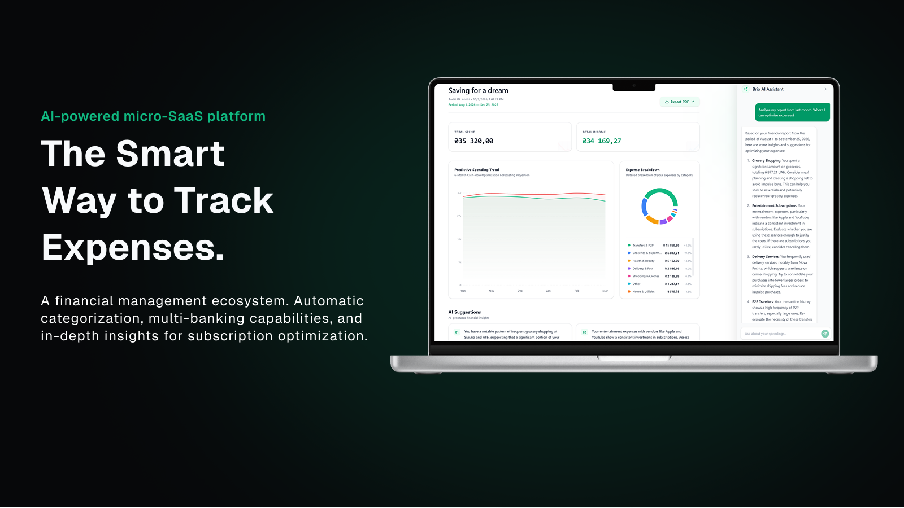
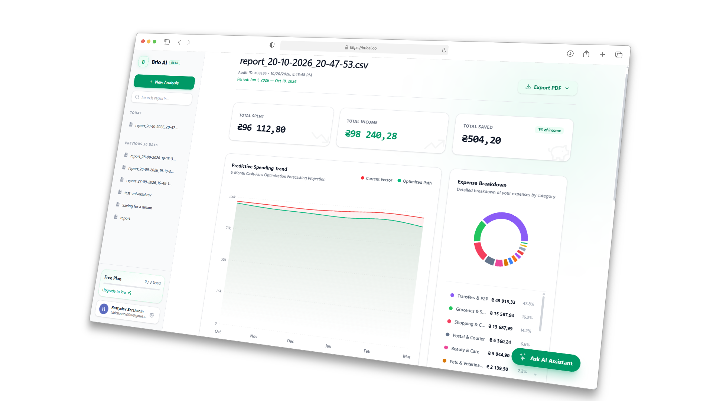
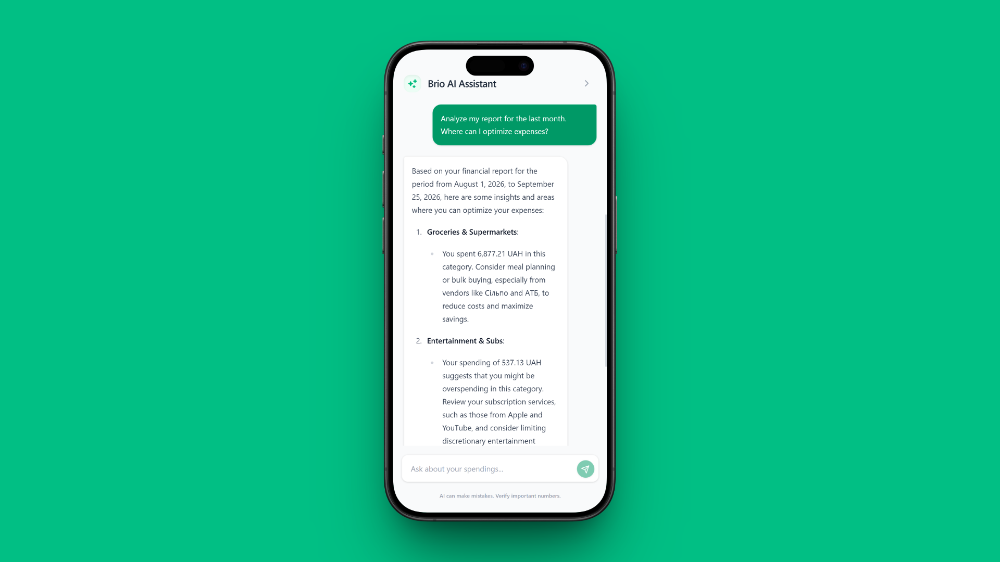
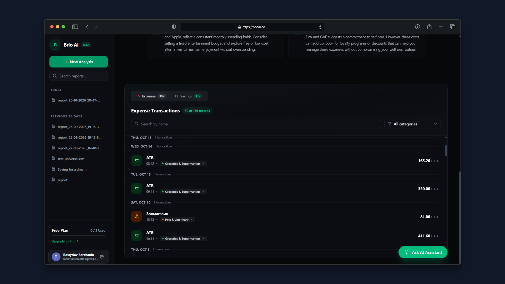
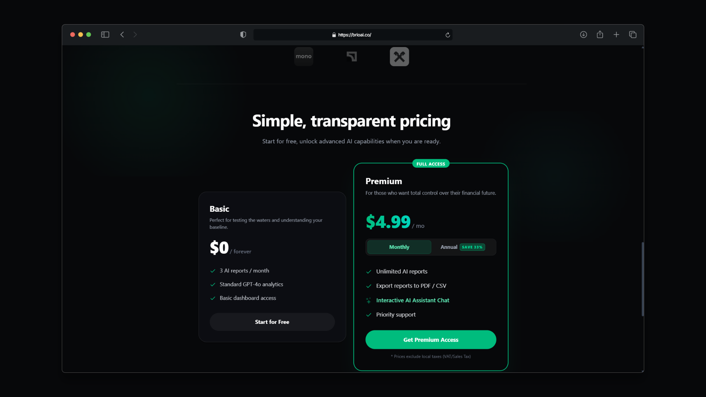

  
  
  # Brio AI — Freemium SaaS Financial Analytics
  
  
  
  
  > **Note:** Brio AI is a proprietary micro-SaaS application. This repository serves as a technical showcase of its architecture, engineering challenges, and sanitized code snippets to demonstrate code quality and architectural patterns.
   
  
  ### 📺 [Watch the 3-minute Architectural Walkthrough](https://youtu.be/sTOwhpTSoM8)
  *See the Pandas pipeline, RAG-assistant, and Paddle webhooks in action.*

---

## Executive Summary

Brio AI is a comprehensive freemium financial analytics platform designed to eliminate manual expense tracking. It allows users to upload local bank statements (CSV/XLSX) for automated categorization, visual analysis, decoupled savings tracking, and AI-driven insights.

Beyond basic categorization, the platform features a fully integrated **domain-principled RAG AI Assistant** with deterministic function-calling tools, automated **WeasyPrint PDF report generation**, and seamless subscription lifecycle management via secure Paddle webhooks.

## 🖥 UI & Feature Gallery

<table align="center">
  <tr>
    <td align="center">
      
       <b>Interactive Data Dashboard & Decoupled Savings</b>
    </td>
    <td align="center">
      
       <b>RAG-Powered Contextual Assistant</b>
    </td>
  </tr>
  <tr>
    <td align="center">
      
       <b>Memoized Client-Side Filtering & Reclassification</b>
    </td>
    <td align="center">
      
       <b>Freemium & Paddle Integration</b>
    </td>
  </tr>
</table>

# System Architecture & Tech Stack

```mermaid
graph TD

    subgraph FE["🖥️ Frontend · Deployed on Vercel"]
        React["⚛️ React 19 + Vite 8 — SPA · Code Splitting · PWA"]
        State["🗂️ State — Context API · Optimistic Updates"]
        Charts["📊 Recharts 3 — D3-powered · Responsive Visuals"]
        React --- State
        React --- Charts
    end

    subgraph BE["⚙️ Backend · Deployed on Render"]
        Django["🐍 Django REST Framework — JWT · Throttling · OpenAPI"]
        Pandas["🔬 Pandas Pipeline — ETL · Normalization · Sniffing"]
        Fuzz["⚡ RapidFuzz — Token-Level Header & Keyword Matching"]
        Presidio["🛡️ Microsoft Presidio — PII Anonymization & Sanitization"]
        Weasy["📄 WeasyPrint — Localized PDF Report Generation"]
        Django --- Pandas
        Django --- Fuzz
        Django --- Presidio
        Django --- Weasy
    end

    subgraph INFRA["☁️ Infrastructure & External Services"]
        DB[("🗄️ Neon PostgreSQL — Serverless · DB Cache · Pooling")]
        OpenAI["🤖 OpenAI API — gpt-4o-mini · Structured Outputs · Function Calling"]
        Paddle["💳 Paddle — Merchant of Record · Global Tax Handling"]
        Telemetry["📡 PostHog & Sentry — Product Analytics · Error Tracking"]
    end

    React <-->|🔒 HTTPS · REST API · JWT| Django
    React -->|🛡️ Telemetry & Observability| Telemetry
    Django <-->|⚡ Django ORM · Cached Aliases| DB
    Django <-->|🧠 Function Calling & Structured Fallback| OpenAI
    Paddle -->|🔐 HMAC-signed Webhooks| Django

    %% ── Node Styles ─────────────────────────────────────────────
    classDef frontendNode  fill:#1d3557,stroke:#457b9d,stroke-width:2px,color:#a8dadc
    classDef backendNode   fill:#2d1b4e,stroke:#7c4dff,stroke-width:2px,color:#ce93d8
    classDef dbNode        fill:#1b3a2d,stroke:#2e7d52,stroke-width:2px,color:#a5d6a7
    classDef aiNode        fill:#3e2723,stroke:#ff7043,stroke-width:2px,color:#ffccbc
    classDef paymentsNode  fill:#1a237e,stroke:#3f51b5,stroke-width:2px,color:#c5cae9
    classDef analyticsNode fill:#37474f,stroke:#546e7a,stroke-width:2px,color:#b0bec5

    class React,State,Charts frontendNode
    class Django,Pandas,Fuzz,Presidio,Weasy backendNode
    class DB dbNode
    class OpenAI aiNode
    class Paddle paymentsNode
    class Telemetry analyticsNode

    %% ── Subgraph Styles ─────────────────────────────────────────
    style FE    fill:#0d1b2a,stroke:#457b9d,stroke-width:2px,color:#a8dadc
    style BE    fill:#1a0a2e,stroke:#7c4dff,stroke-width:2px,color:#ce93d8
    style INFRA fill:#0d1a14,stroke:#2e7d52,stroke-width:2px,color:#a5d6a7
```

### 🛠 Tech Stack

- **Frontend (Client):** React 19, TypeScript, Vite 8, Tailwind CSS v4, Recharts 3 (6-month Predictive Spending Trend, Volume Segmentation), i18n, React Context. Deployed on Vercel.
- **Backend (API & Processing):** Django 5.1, Django REST Framework (DRF), Pandas 2.2, RapidFuzz 3.10, WeasyPrint for publication-grade PDF generation. Deployed on Render.
- **Database:** Serverless PostgreSQL hosted on Neon.tech with connection pooling and merchant alias DB caching.
- **AI & Privacy:** OpenAI API (`gpt-4o-mini`) utilizing Structured Outputs (Pydantic), Function Calling, and Microsoft Presidio (`uk_core_news_sm`) for local PII anonymization and placeholder sanitization.
- **Payments & Auth:** Paddle (Merchant of Record) via secure HMAC-signed webhooks, `django-allauth` (JWT + Google OAuth2).
- **Analytics & Observability:** PostHog (behavioral product analytics & opt-in GDPR compliance) and Sentry (real-time client-side exception monitoring).

---

## Engineering Challenges & Solutions

### 1. Smart Data Ingestion & Decoupled Savings Engine

**The Challenge:** Bank statements vary drastically across institutions (Monobank, PrivatBank, Raiffeisen, and long-tail regional banks) with inconsistent column labels, encoding quirks, and delimiter variance. Furthermore, automated micro-savings (purchase roundups and vault transfers) artificially inflate `total_spent` and distort category pie charts if treated as consumer spending.  
**The Solution:**

- **GoF Strategy & Factory Patterns:** Implemented a polymorphic `BankParserFactory` with a heuristic `BankSniffer` that inspects internal DataFrame column signatures rather than untrustworthy filenames.
- **Universal Ukrainian Parser (Tiered Fuzzy Fallback):** For unsupported banks, implemented a two-pass column discovery strategy:
  - _Pass 1 (Deterministic):_ Fast substring containment combined with negative exclusion filters (eliminating fees, cashback, and running balances).
  - _Pass 2 (Token-Level RapidFuzz):_ Enforces acronym length guards (`len >= 4`) and word length proximity tolerance (`abs(len(token) - len(kw)) <= 2`) to completely eliminate false-positive collisions on short financial keywords (`date` vs `rate`, `amount` vs `account`).
- **Decoupled Savings Architecture:** The ingestion engine detects automated piggy-bank rules and roundups (`is_auto_savings`), segregating internal wealth accumulation (`total_saved`, `savings_transactions`) from living consumption (`total_spent`). Expense pie charts remain 100% pure while users gain full audit visibility into their savings.

### 2. Cost-Optimized 6-Stage Categorization & Cross-Lingual DB Caching

**The Challenge:** Relying solely on LLMs to categorize thousands of rows per upload is cost-prohibitive, introduces high latency, and fails on domain-specific edge cases (e.g., military fundraisers and charity jars recorded under generic banking P2P transfer codes).  
**The Solution:**
Transactions flow through a cascading 6-stage pipeline before ever touching an external API:

1. **PII Redaction & Noise Cleaning:** Presidio masks personal names while custom regex strips POS/terminal noise (`_POS`, `_ATM`, `_PNFP`), card numbers, and cities.
2. **MCC & Smart Fundraiser Detection (`is_charity_transfer`):** Intercepts generic P2P transfer MCCs (`4829`/`6012`) and inspects descriptions against charity, military campaign (_FPV drones, Come Back Alive, United24, Prytula Foundation_), and raffle patterns, routing them directly to _Charity & Donations_.
3. **Exact Category Keyword Matching:** Matches transactions against Brio's 14 canonical Level 1 categories.
4. **Fuzzy Keyword Matching:** Uses RapidFuzz (`partial_ratio > 85`) over curated localized merchant roots.
5. **Cross-Lingual DB Caching (`MerchantCategoryAlias`):** Caches previously resolved unknown merchants in PostgreSQL with exact core extraction and fuzzy alias similarity. Features bidirectional translation (UK $\leftrightarrow$ EN) to prevent language leakage across multilingual reports.
6. **Concurrent AI Fallback (OpenAI `gpt-4o-mini`):** Discards all resolved merchants and sends only genuinely novel entities to OpenAI using Pydantic Structured Outputs (`client.beta.chat.completions.parse`), persisting new mappings back to the database cache for future instant hits.

### 3. Domain-Principled RAG Financial Assistant

**The Challenge:** Standard conversational LLM wrappers provide generic financial advice and hallucinate mathematical calculations when analyzing complex statement data.  
**The Solution:**
Developed an in-memory RAG assistant governed by behavioral finance principles:

- **Advisory Framework (`apps/analytics/chat/prompts.py`):** Automatically classifies the user's spending into **Discretionary Wants** (dining, shopping, entertainment), **Living Essentials / Needs** (groceries, health & medicine, utilities), **Commitments & Allocations** (charity, family transfers), and **Savings & Accumulations** (vaults, roundups), preventing the AI from inappropriately advising users to cut essential living costs or charitable commitments.
- **Deterministic Function-Calling Tool (`query_transactions`):** The LLM never calculates sums or breakdowns mentally; it executes deterministic server-side operations (`sum`, `count`, `max`, `min`, `category_summary`, `breakdown`, `list`).
- **Slavic Grammatical Inflection Tolerance (`_matches_term`):** Integrates stem-based matching so queries for inflected nouns (e.g. searching `"банка"` matches `"до банки"` or `"на банку"`) resolve accurately.

### 4. Cost-Effective Freemium Architecture & Real-Time MoR

**The Challenge:** Maintaining a freemium model requires resetting free credits (`free_analyses_left`) every 30 days and managing premium subscriptions without inflating server overhead with heavy background workers like Celery + Redis.  
**The Solution:**

- **Serverless Cron Jobs:** Replaced Celery with lightweight GitHub Actions workflows that trigger secure backend endpoints for monthly quota resets.
- **Secure Paddle State Machine:** Validates HMAC SHA-256 signatures on all webhook events and enforces a business-logic "Grace Period", allowing canceled users to retain premium entitlements strictly until their billing period concludes.

### 5. Concurrency-Safe JWT Rotation & Request Queueing

**The Challenge:** When an access token expires while multiple dashboard widgets (financial metrics, recent transactions, report history, user status) fire concurrent API calls, naive interceptors trigger multiple simultaneous `/token/refresh/` requests. This leads to refresh-token rotation race conditions, invalid tokens, and jarring user logouts.  
**The Solution:**
Implemented a client-side **Mutex Promise Queue** in [`api.ts`](./core-snippets/frontend/api.ts). When the first 401 is intercepted:

- A lock flag (`isRefreshing = true`) halts subsequent outgoing retry requests.
- Concurrent failed requests are pushed into a pending memory queue with their `resolve`/`reject` promises held.
- A single atomic refresh call is executed; once successful, the queue drains (`processQueue`), injecting the new Bearer token and re-executing all stalled requests invisibly with zero UI disruption.

---

## Featured Code Snippets

The `/core-snippets` directory contains sanitized, production-ready code samples isolated from the main repository. These files demonstrate code quality, type safety, and architectural decisions.

### ⚡ Backend (`/core-snippets/backend`)

- [`bank_strategy_pattern.py`](./core-snippets/backend/1_bank_strategy_pattern.py) — Demonstrates the implementation of the Factory and Strategy GoF patterns for dynamic CSV statement ingestion, format sniffing, and the tiered Universal Ukrainian Parser.
- [`ai_analysis.py`](./core-snippets/backend/2_ai_financial_analysis.py) — Showcases modern OpenAI API usage with Structured Outputs (Pydantic) for AI categorization fallback, parallelized insight generation, and Presidio PII redaction.
- [`paddle_webhook.py`](./core-snippets/backend/3_paddle_webhook_grace_period.py) — Highlights security-first webhook processing, HMAC cryptographic validation, and the subscription state machine (Grace Period logic).

### 🎨 Frontend (`/core-snippets/frontend`)

- [`api.ts`](./core-snippets/frontend/api.ts) — An advanced Axios interceptor implementing JWT refresh token rotation with a Mutex/Promise queue to prevent race conditions during concurrent 401 requests.
- [`AnalysisForm.tsx`](./core-snippets/frontend/AnalysisForm.tsx) — A complex, localized Drag-and-Drop UI component with event-driven PostHog analytics tracking and dynamic Tailwind styling.
- [`useSidebarData.ts`](./core-snippets/frontend/useSidebarData.ts) — A custom hook demonstrating the "Headless Component" pattern: separating business logic, managing local state updates (to avoid network refetches), and handling client-side pagination.
- [`ThemeProvider.tsx`](./core-snippets/frontend/ThemeProvider.tsx) — An enterprise-grade theme provider featuring centralized options, system preference media queries, dynamic favicon swapping, cross-tab synchronization via Storage events, and Safari chrome tinting.

## 🔒 Privacy & Data Minimization

Security and privacy are foundational to Brio AI's architecture. The platform operates on a strict **data minimization** principle:

- **In-Memory Processing:** Uploaded statements (CSV/XLSX) are parsed entirely in-memory and immediately purged. Raw bank files are never stored on persistent server disks.
- **Zero-PII Storage & Placeholder Sanitization:** Name, tax numbers, and account balances are stripped during extraction. **Microsoft Presidio** actively redacts personal identifiers from vendor descriptions, and natural language post-processing ensures no raw `<PERSON>` placeholders leak into user-facing AI insights.
- **User Control:** Users retain full control to delete individual statement rows or remove historical reports and associated chat threads at any time.
